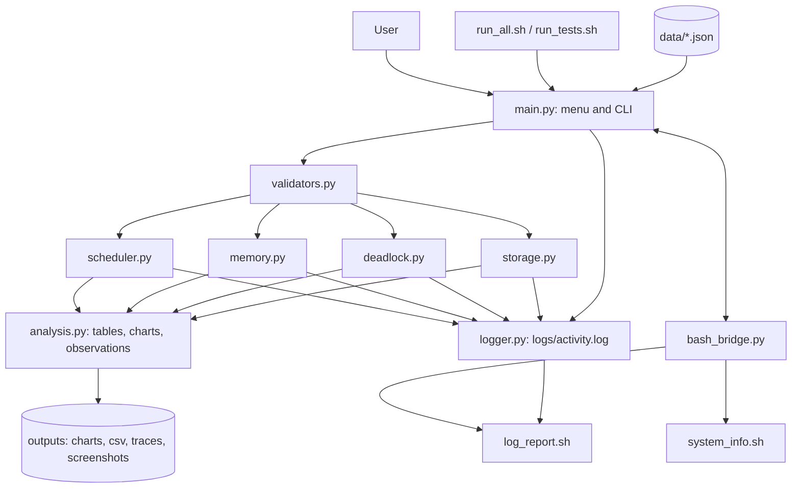
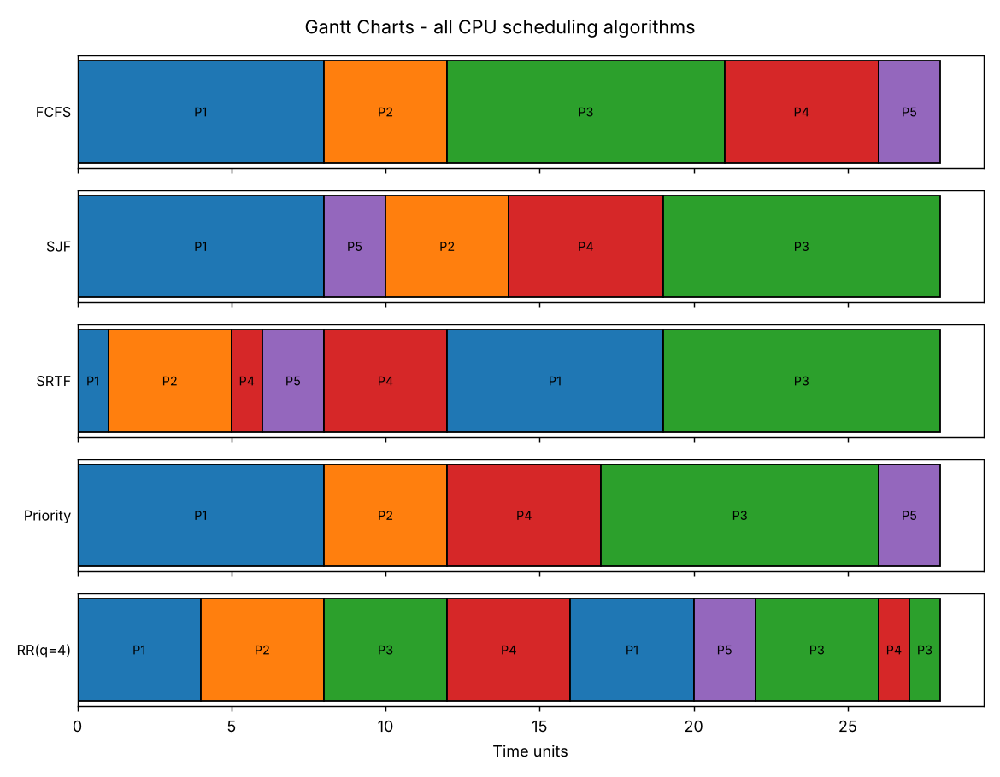
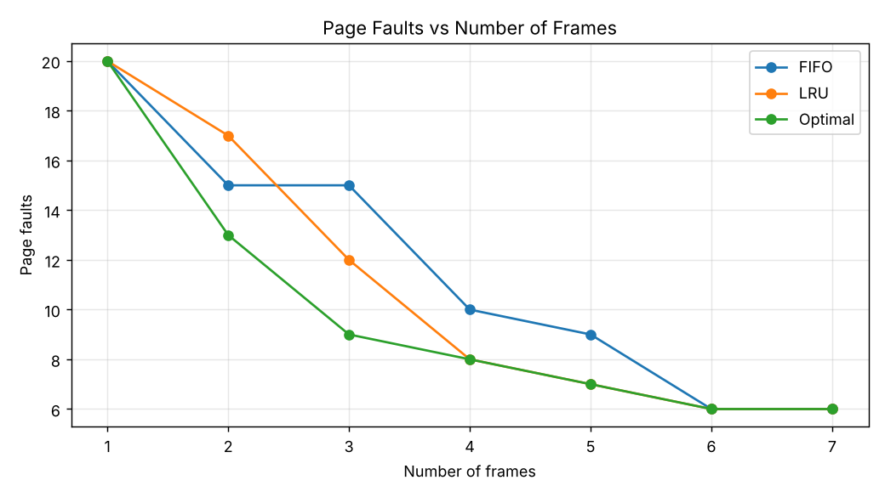
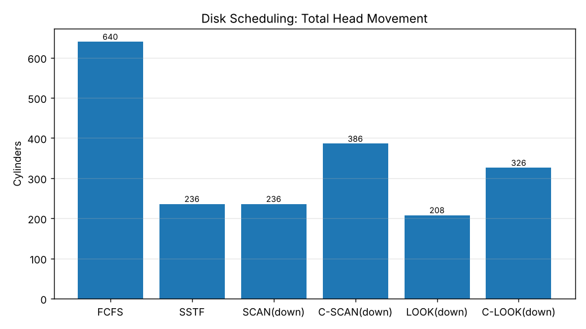

## Author

`<Nikhil Dhandhi>` - `<2401360026 / B.Tech CSE UI/UX>`

# OSim - OS Resource Management Simulator

An integrated **Python + Bash** application that simulates the major resource-management functions of an
operating system (CPU scheduling, memory management, deadlock handling and disk/storage scheduling) and
presents clear, comparable analytical results (tables, charts, observations).

> Capstone project - Operating Systems. All modules share one menu, one validation layer, one logger and one
> analysis engine, so it runs as a single integrated project rather than separate programs.

## Features

| Module | Algorithms / functions |
|---|---|
| **CPU Scheduling** | FCFS, SJF, SRTF (preemptive), Priority, Round Robin - Gantt chart, waiting / turnaround / response time, CPU utilization, throughput, context switches |
| **Memory Management** | Page replacement: FIFO, LRU, Optimal (+ Belady's anomaly demo). Contiguous allocation: First / Best / Worst fit with fragmentation report |
| **Deadlock** | Banker's algorithm (safety check, safe sequence, request granting with rollback) and deadlock detection |
| **Storage** | Disk scheduling: FCFS, SSTF, SCAN, C-SCAN, LOOK, C-LOOK |
| **Analysis** | Runs common datasets through every algorithm, writes tables (TXT/CSV), labelled charts (PNG) and technical observations |
| **Bash integration** | Live system info (`/proc`, `ps`, `df`), activity-log analytics (`awk`/`grep`), one-command demo runner |
| **Reliability** | Input validation, exception handling, activity logging, 47 automated tests |

## Architecture and workflow



Data design: every module reads simple JSON datasets from `data/` (processes, reference strings, resource
matrices, disk queues). Each algorithm returns a result object (dataclass) holding the raw trace and metrics, which
is formatted for the terminal and reused by the analysis engine - so numbers shown in the menu and in the charts
always come from the same computation.

## Project structure

```
os-resource-simulator/
|-- main.py                  # interactive menu + argparse CLI
|-- osim/
|   |-- scheduler.py         # Module 1: CPU scheduling
|   |-- memory.py            # Module 2: paging + contiguous allocation
|   |-- deadlock.py          # Module 3: Banker's + detection
|   |-- storage.py           # Module 4: disk scheduling
|   |-- analysis.py          # comparisons, tables, charts, observations
|   |-- validators.py        # input validation (ValidationError)
|   |-- logger.py            # activity logging
|   `-- bash_bridge.py       # Python -> Bash integration
|-- scripts/
|   |-- run_all.sh           # one-command demo (tests + all modules + reports)
|   |-- run_tests.sh         # run tests, save evidence
|   |-- system_info.sh       # live OS snapshot
|   |-- log_report.sh        # log analytics with awk/grep
|   `-- make_screenshots.py  # regenerate terminal screenshots
|-- data/                    # sample inputs (JSON)
|-- tests/                   # 47 test cases (valid, invalid, boundary, integration)
|-- outputs/
|   |-- traces/              # output traces of every run
|   |-- charts/              # PNG visualisations
|   |-- screenshots/         # terminal screenshots
|   `-- *.csv                # comparison tables
|-- REPORT.md                # concise project report
`-- requirements.txt
```

## Requirements

* Python 3.9+
* Bash (Linux / macOS / Git Bash or WSL on Windows)
* `matplotlib` (charts) - `pip install -r requirements.txt`
* `Pillow` is only needed to regenerate screenshots (`pip install pillow`)

## Execution steps

```bash
git clone https://github.com/<your-username>/os-resource-simulator.git
cd os-resource-simulator
pip install -r requirements.txt

# 1) Interactive menu (recommended for demonstration)
python3 main.py

# 2) One-command full demo: tests + every module + analysis + bash reports
bash scripts/run_all.sh

# 3) Individual modules (non-interactive)
python3 main.py schedule --algo rr --quantum 4
python3 main.py schedule --input data/processes.json --algo all
python3 main.py memory --algo lru --frames 3 --refs "7 0 1 2 0 3 0 4 2 3 0 3 2 1 2 0 1 7 0 1"
python3 main.py deadlock
python3 main.py disk --algo scan
python3 main.py analyze          # tables + charts in outputs/
python3 main.py sysinfo          # Bash: live system information
python3 main.py logreport        # Bash: activity-log summary

# 4) Tests
bash scripts/run_tests.sh        # or: python3 -m unittest discover -s tests -v
```

### Menu flow

```
MAIN MENU
  [1] CPU Process Scheduling         [5] Run full analysis & generate charts
  [2] Memory Management              [6] Live system information (Bash)
  [3] Deadlock (Banker's + detection)[7] Activity log summary (Bash)
  [4] Disk / Storage Scheduling      [0] Exit
```
Every prompt has a sensible default (press Enter), and invalid input prints a clear message without crashing.

## Sample input

`data/processes.json`
```json
{"quantum": 4, "processes": [
  {"pid": "P1", "arrival": 0, "burst": 8, "priority": 3},
  {"pid": "P2", "arrival": 1, "burst": 4, "priority": 1},
  {"pid": "P3", "arrival": 2, "burst": 9, "priority": 4},
  {"pid": "P4", "arrival": 3, "burst": 5, "priority": 2},
  {"pid": "P5", "arrival": 6, "burst": 2, "priority": 5}]}
```
Other samples: `data/memory.json`, `data/deadlock.json`, `data/disk.json`. You may pass your own file with `--input`.

## Sample output (excerpt)

```
=== CPU Scheduling: RR(q=4) ===
|   P1   |   P2   |   P3   |   P4   |   P1   |  P5 |   P3   |  P4 |  P3 |
```
Full traces for every module are in [`outputs/traces/`](outputs/traces) and screenshots in
[`outputs/screenshots/`](outputs/screenshots).

### Key results (common datasets)

| CPU scheduling | Avg WT | Avg TAT | Avg RT | Ctx switches |
|---|---|---|---|---|
| FCFS | 11.0 | 16.6 | 11.0 | 4 |
| SJF | 7.8 | 13.4 | 7.8 | 4 |
| **SRTF** | **6.4** | **12.0** | **3.8** | 6 |
| Priority | 10.2 | 15.8 | 10.2 | 4 |
| RR (q=4) | 13.0 | 18.6 | 6.4 | 8 |

| Page faults (3 frames, 20 refs) | FIFO | LRU | Optimal |
|---|---|---|---|
| Faults | 15 | 12 | 9 |

| Disk (head 53, 8 requests) | FCFS | SSTF | SCAN | C-SCAN | LOOK | C-LOOK |
|---|---|---|---|---|---|---|
| Head movement | 640 | 236 | 236 | 386 | **208** | 326 |

Deadlock: initial state is **safe** (sequence `P1 -> P3 -> P4 -> P0 -> P2`); a request by P4 for `[3,3,0]`
is denied and a request by P0 for `[0,2,0]` is denied because it would lead to an unsafe state.





## Testing

`tests/` contains 47 test cases: known textbook results for each algorithm, **invalid** input (negative / zero /
non-numeric / duplicate / ragged matrices / out-of-range cylinders), **boundary** input (single process, one frame,
request at head position, quantum larger than any burst, requests at disk edges), CLI behaviour (bad file, corrupt
JSON, bad menu input, EOF), Bash integration and artefact generation. Evidence: `outputs/traces/test_results.txt`.

## Logging

Each run appends to `logs/activity.log` (`time|LEVEL|module|message`); `scripts/log_report.sh` summarises it with
awk. A sample is saved in `outputs/traces/activity_sample.log`.

## Phase mapping (assignment rubric)

| Phase | Where it is covered |
|---|---|
| 1 - System Design and Planning (20) | Architecture diagram + data design above, `REPORT.md` sections 1-2 |
| 2 - Core Resource-Management Modules (20) | `osim/scheduler.py`, `memory.py`, `deadlock.py`, `storage.py` (4 modules), Bash scripts, menu in `main.py` |
| 3 - Analysis and Comparison (20) | `osim/analysis.py`, `outputs/charts/`, `outputs/*.csv`, `outputs/analysis_report.txt` |
| 4 - Testing and Reliability (20) | `tests/`, `osim/validators.py`, exception handling in `main.py`, `osim/logger.py` |
| 5 - Documentation and Demonstration (20) | This README, `REPORT.md`, `outputs/screenshots/`, `outputs/traces/`, `scripts/run_all.sh` |

## License

MIT
